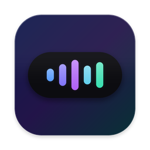

<div align="center">
  
  <h1>TrackPeek</h1>
  <p><strong>Your music, within reach.</strong></p>
  <p>Spotify and Apple Music controls for your menu bar, notch, and desktop.</p>
  <p>
    <a href="https://github.com/Komortes/TrackPeek/releases/latest"></a>
    
  </p>
  <p>
    <a href="https://github.com/Komortes/TrackPeek/releases/download/v1.1/TrackPeek-1.1-build5.zip"><strong>Download 1.1 for macOS</strong></a>
    &nbsp;·&nbsp; <a href="docs/releases/1.1.md">Release notes</a>
    &nbsp;·&nbsp; <a href="docs/USAGE.md">Usage guide</a>
  </p>
</div>

## What you can do

- **Choose your place.** A menu bar player, full or Focus notch, and ten desktop widget templates. A physical notch is optional for menu bar and desktop widgets.
- **Stay in your flow.** Play, pause, skip and seek without switching apps. Use global shortcuts, keyboard controls, and source-supported shuffle, repeat and volume.
- **Follow the words.** Synchronized lyrics, Karaoke, and a full-song reader with line seeking, manual reading, retries and timing adjustment.
- **Make it yours.** Pick a monitor, position and artwork palette. Choose Automatic or Economical resource usage, with connection diagnostics when you need them.

## Install

1. Download [TrackPeek 1.1 (build 5)](https://github.com/Komortes/TrackPeek/releases/download/v1.1/TrackPeek-1.1-build5.zip).
2. Unzip it, move `TrackPeek.app` to `/Applications`, and open it.
3. Start Spotify or Apple Music and allow **Automation** access when macOS asks.
4. Choose a player and surface in onboarding or Settings. The menu bar remains available when the desktop overlay is off.

Requires **macOS 14 or later**. The live equalizer needs **macOS 14.2 or later** and audio-capture permission. The 1.1 archive supports Apple silicon and Intel; runtime verification was performed on an Apple silicon Mac with macOS 26.2.

Choose **English, Українська, Русский, or Follow macOS** in **Settings → General → App Language**. The choice is saved for TrackPeek independently of the system language. Use **Restart Now** to apply it and reopen Settings; your other preferences are retained.

Releases use **Apple Development signing and are not notarized**. If macOS blocks first launch, follow [Apple's instructions](https://support.apple.com/en-asia/guide/mac-help/mh40616/mac) for a download you trust. See [release preparation](docs/RELEASING.md) for the distribution details.

## A place on your desktop

Choose a monitor and a preset position, or enable free movement. Appearance controls adapt to the selected widget template; your choices stay saved when you switch layouts.

Right-click the player or use its **…** menu for source selection, lyrics, appearance and quick actions. For keyboard controls, all templates, resource modes and troubleshooting, see the [usage guide](docs/USAGE.md).

## Privacy

Playback uses local Apple Events. No separate Spotify or Apple Music web login is required, and TrackPeek does not keep a listening-history database.

Lyrics requests send song metadata to LRCLIB. Remote artwork uses player-provided URLs; Apple Music artwork uses a temporary local file. Sparkle checks GitHub for updates. Diagnostic reports exclude song metadata and personal paths. See [network and permission behavior](docs/USAGE.md#privacy-and-network-use).

## Development


Built with **Swift 6, SwiftUI and AppKit**. Use the Xcode project; the root `Package.swift` does not configure the complete app. Setup, tests and conventions are in [CONTRIBUTING.md](CONTRIBUTING.md).

Pull requests run script and localization checks, app tests with coverage, and a universal Release build. See [CI runs](https://github.com/Komortes/TrackPeek/actions/workflows/ci.yml) and the [Git workflow](docs/GIT_WORKFLOW.md) for contribution and merge rules.

See [localization](docs/LOCALIZATION.md) for language resources, translation conventions and validation.

<details>
<summary>Build and run locally</summary>

Use Xcode with Swift 6 support and [XcodeGen](https://github.com/yonaskolb/XcodeGen). The current toolchain is Xcode 26.6.

```sh
brew install xcodegen
git clone https://github.com/Komortes/TrackPeek.git
cd TrackPeek
```

Configure your own `DEVELOPMENT_TEAM` and signing identity in `project.yml` for the app, helper, and tests, then:

```sh
xcodegen generate
./script/build_and_run.sh --verify
```

The helper builds Debug for arm64, stops the running TrackPeek process, and launches `.build/xcode/Build/Products/Debug/TrackPeek.app`. Use Xcode directly for another destination. Regenerate the project after adding files or changing configuration.

See [contributing](CONTRIBUTING.md#verification) for app-hosted tests, release-script checks and review conventions.

</details>

<details>
<summary>Project structure</summary>

| Path | Contents |
| --- | --- |
| `Sources/Models`, `Services`, `Stores` | Playback state, preferences, source routing, audio, lyrics, and shared caches |
| `Sources/Views`, `Support` | SwiftUI surfaces, settings, AppKit windows, displays, and updates |
| `Helpers/`, `Shared/` | Isolated AppleScript process and bounded IPC protocol |
| `Tests/` | App-hosted regression tests |
| `script/` | Build/run, validated release preparation, and script tests |
| `project.yml`, `TrackPeek.xcodeproj` | XcodeGen definition and generated Xcode project |
| `docs/` | Usage, product plans, verification records, and release notes |

</details>

[Usage guide](docs/USAGE.md) · [Changelog](CHANGELOG.md) · [Contributing](CONTRIBUTING.md) · [Releasing](docs/RELEASING.md) · [Product roadmap](docs/product/ROADMAP.md)
